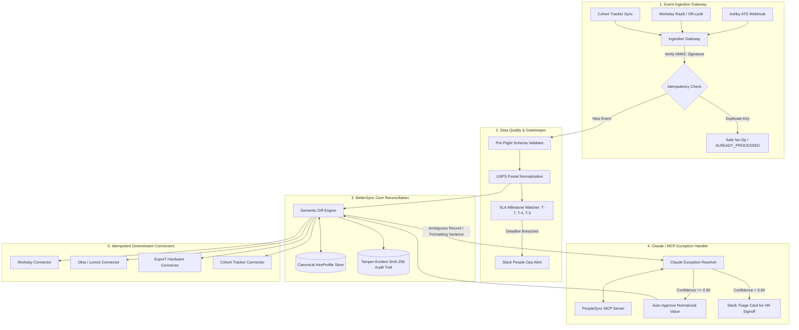

# BetterSync: Enterprise People Systems Orchestration Engine

[](https://www.python.org/)
[](file:///D:/Projects/ai_assignment/tests)
[](https://docs.pydantic.dev/)
[](file:///D:/Projects/ai_assignment/SYSTEMS_MAP.md)
[](file:///D:/Projects/ai_assignment/mcp_server.py)

> **BetterUp People Technology — AI Automation Engineer Take-Home Exercise**  
> **Candidate Submission**  
> **Reviewer:** Jessica Brewer (`jessica.brewer@betterup.co`)  
> **Deliverable Format:** Complete Code Repository, Architecture Map, Build Note & Demo Walkthrough Script

---

## 📑 Table of Contents
1. [Executive Summary & Problem Statement](#-executive-summary--problem-statement)
2. [Deliverables Mapping](#-deliverables-mapping)
3. [Architecture & System Flow](#-architecture--system-flow)
4. [The Highest-Leverage Slice](#-the-highest-leverage-slice)
5. [Key Engineering Capabilities](#-key-engineering-capabilities)
6. [Interactive Walkthrough & Scenarios](#-interactive-walkthrough--scenarios)
7. [Repository File Structure](#-repository-file-structure)
8. [Quickstart & Running Locally](#-quickstart--running-locally)
9. [Running the Test Suite](#-running-the-test-suite)
10. [Bonus Features: MCP Server, Auth, & Audit Chain](#-bonus-features)
11. [Loom / Video Walkthrough Script (for Debrief)](#-loom--video-walkthrough-script-for-debrief)

---

## 🚀 Executive Summary & Problem Statement

At **BetterUp**, high hiring velocity strains the boundary lines between five fragmented People systems:
* **Ashby**: Applicant Tracking System (ATS)
* **Workday**: Core Human Capital Management (HRIS & System of Record)
* **Okta / Lumos**: Identity Governance and Administration (IGA / IdP)
* **ExpoIT**: Hardware procurement, asset management, and direct-to-employee shipping logistics
* **Cohort Tracker**: Operational cohort tracking across People Operations

### Today's Fragile State (The 3 Core Breakages)
1. **Changes Don't Propagate**: Post-offer adjustments (start date postponements, legal name updates, residential address changes) and off-cycle hires created directly in Workday do not ripple down to Okta, ExpoIT, or tracking spreadsheets. Hardware arrives at old addresses; Okta accounts activate on wrong dates.
2. **Bad Data Cascades**: Unchecked typos, missing apartment numbers, and malformed state codes flow straight from candidate entry into Workday, shipping labels, and Okta email handles.
3. **Unmonitored SLA Gates**: Critical onboarding gates (IT hardware selection forms, background check clearances, and Okta staging) have strict T-7 day deadlines that are chased manually or discovered only when a new hire starts Day 1 without equipment or system access.

### The Solution: BetterSync
**BetterSync** is an event-driven reconciliation engine that:
* Ingests upstream webhooks and change events with **cryptographic replay protection**.
* Normalizes addresses and validates data quality invariants **before** cascading updates.
* Idempotently propagates changes across Workday, Okta, ExpoIT, and the Cohort Tracker.
* Proactively monitors **T-7, T-4, and T-3 SLA milestones**, auto-remediating issues or alerting People Ops Slack.
* Employs **Claude via Model Context Protocol (MCP)** as a bounded, agentic exception handler to resolve semantic ambiguities without human intervention.

---

## 📋 Deliverables Mapping

| Required Deliverable | Repository Asset | Description |
| :--- | :--- | :--- |
| **1. Systems Map (~20 min)** | [SYSTEMS_MAP.md](file:///D:/Projects/ai_assignment/SYSTEMS_MAP.md) | As-Is vs. To-Be architectures, failure mode deep dive, System of Record (SoR) matrix, and engineering slice justification. |
| **2. Runnable Prototype** | [run_demo.py](file:///D:/Projects/ai_assignment/run_demo.py) & [src/](file:///D:/Projects/ai_assignment/src) | Complete runnable codebase with mocked connectors, webhook handlers, diff reconciler, SLA gatekeeper, and Claude triage. |
| **Walkthrough Video Recording** | [bettersync_demo_walkthrough.webm](file:///D:/Projects/ai_assignment/bettersync_demo_walkthrough.webm) | Recorded HD walkthrough video demonstrating change propagation, Claude exception triage & SLA gates. |
| **3. Short Build Note** | [BUILD_NOTE.md](file:///D:/Projects/ai_assignment/BUILD_NOTE.md) | Engineering design decisions, canonical data model, idempotency formula, productionization roadmap, and AI reflection with a real caught error. |
| **Bonus 1: Model Context Protocol (MCP)** | [mcp_server.py](file:///D:/Projects/ai_assignment/mcp_server.py) & [src/agent/mcp_tools.py](file:///D:/Projects/ai_assignment/src/agent/mcp_tools.py) | Standards-compliant JSON-RPC MCP Server exposing 5 People Ops tools to Claude Desktop, Claude Code, or Cursor. |
| **Bonus 2: Security & Enterprise Auth** | [SECURITY_AUTH.md](file:///D:/Projects/ai_assignment/SECURITY_AUTH.md) | OAuth 2.0 JWT Bearer grants, Okta SSO, token caching in HashiCorp Vault, and constant-time HMAC webhook verification. |
| **Bonus 3: Cryptographic Audit Trail** | [src/core/audit_logger.py](file:///D:/Projects/ai_assignment/src/core/audit_logger.py) | Tamper-evident append-only SHA-256 event chaining with automated validation. |

---

## 🏗 Architecture & System Flow



---

## 🎯 The Highest-Leverage Slice

Rather than selecting a narrow slice that ignores the others, we built **Unified Change Propagation & Invariant Gatekeeping (with Agentic Discrepancy Resolution)**:

1. **Why not *only* data validation?** Catching a typo is good, but does not solve the primary operational fire: an unpropagated start date change that causes a laptop to be delivered to an empty house two weeks early.
2. **Why not *only* exception monitoring?** Sending Slack alerts when deadlines pass tells People Ops where the fires are, but does nothing to extinguish them automatically.
3. **The High-Leverage Union**:
   * **Reconciliation Engine**: Calculates state diffs and idempotently pushes updates downstream.
   * **Pre-Flight Invariant Checker**: Enforces address standards and required fields before downstream mutation.
   * **SLA Gatekeeper**: Proactively monitors T-7 deadlines (hardware form, background check, Okta staging).
   * **Claude via MCP**: Resolves fuzzy discrepancies (e.g. "Ste 400" vs "Suite 400", legal name vs preferred name) automatically without manual HR intervention.

---

## ⚙️ Key Engineering Capabilities

### 1. Hash-Based Idempotency & Replay Protection
Every action calculates a deterministic SHA-256 key:
$$\text{idempotency\_key} = \text{SHA256}(\text{hire\_id} + \text{target\_system} + \text{action} + \text{payload\_hash})$$
Duplicate webhook retries or accidental re-submissions are detected immediately and returned as safe no-ops without redundant external API mutations.

### 2. Canonical Data Model with Pydantic v2
* Single source of truth model: [`HireProfile`](file:///D:/Projects/ai_assignment/src/models/canonical.py).
* Validates email formats (`@betterup.co`), US postal abbreviations, state codes, and start date ISO formats.
* Generates a reproducible state fingerprint (`compute_hash()`) to detect cross-system drift.

### 3. SLA Gatekeeper & Proactive Alerts
* **T-7 Hardware Form Gate**: Flags missing laptop selection forms $\ge 7$ days before start.
* **T-7 Background Check Gate**: Flags incomplete background checks $\ge 7$ days out.
* **T-4 Hardware Dispatch Gate**: Flags un-shipped equipment $\ge 4$ days out, triggering courier escalation.
* **T-3 Okta Staging Gate**: Verifies Okta account is staged and scheduled for Day 1 06:00 AM activation.

### 4. Claude Agentic Exception Resolver
* Uses **Claude 3.5 Sonnet** (via Anthropic API) with high-fidelity deterministic local fallback.
* Reasons over semantic equivalences (postal abbreviations, whitespace differences, casing).
* Applies confidence scoring: $\ge 0.90$ auto-resolves and synchronizes; $< 0.90$ formats an actionable Slack card for People Ops signoff.

### 5. Cryptographic Append-Only Audit Trail
* Implements blockchain-style SHA-256 event chaining:
  $$\text{current\_hash} = \text{SHA256}(\text{record\_id} + \text{timestamp} + \text{diff} + \text{prev\_hash})$$
* Guarantees tamper-evidence for compliance (SOC 2, GDPR, SOX). If any entry or diff is altered, `verify_integrity()` immediately fails.

---

## 🧪 Interactive Walkthrough & Scenarios

The runnable CLI demo ([`run_demo.py`](file:///D:/Projects/ai_assignment/run_demo.py)) walks through 5 real-world scenarios:

```
+------------------------------------------------------------------------------+
| BetterUp People Technology -- Onboarding Orchestration Engine                |
| Engineering Depth Demo: Change Propagation, SLA Gates & Claude Exception     |
| Triage                                                                       |
+------------------------------------------------------------------------------+

SCENARIO 1: Post-Offer Change Propagation
* Elena Rostova signs offer for 2026-11-02.
* Candidate moves start date to 2026-11-16 and updates address to 450 Mission St.
* BetterSync ripples updates across Workday, Okta, and ExpoIT in real time.
[OK] Success: Start date & shipping address propagated cleanly without manual IT tickets!

SCENARIO 2: Bad Data Cascades & Agentic Claude Discrepancy Triage
* Discrepancy detected: Ashby has '100 main street ste 400', Workday has '100 Main St, Suite 400'.
* Claude analyzes postal standards: "Semantic equivalence confirmed. Confidence: 96%."
[OK] Success: Claude safely normalized the address, preventing courier address correction fees.

SCENARIO 3: SLA Gatekeeper (Unmonitored Deadlines)
* Priya Patel starts in 5 days (T-5).
* Gatekeeper catches: Hardware Form missing (HIGH) and Background Check PENDING (HIGH).
* Generates structured Slack alert with auto-remediation actions.
[OK] Success: Proactively surfaced all 3 blocking issues before Day 1!

SCENARIO 4: Strict Idempotency & Replay Protection
* Resending identical event key 'start_date_update_HIRE-1001'.
* Result Status: ALREADY_PROCESSED | Idempotent: True
[OK] Success: Duplicate event blocked with 0 redundant writes or downstream calls!

SCENARIO 5: Cryptographic Audit Trail Verification
* Validating SHA-256 hash chain from genesis block to head.
* Audit Trail Cryptographic Integrity Check: VALID (No Tampering Detected)
```

---

## 📁 Repository File Structure

```
ai_assignment/
├── README.md                      # Complete project documentation & guide
├── SYSTEMS_MAP.md                 # Deliverable 1: Systems map, failure points & slice defense
├── BUILD_NOTE.md                  # Deliverable 3: Design decisions, idempotency & AI reflection
├── SECURITY_AUTH.md               # Bonus: Enterprise OAuth 2.0 / SSO token management
├── pytest.ini                     # Pytest configuration
├── requirements.txt               # Dependencies (FastAPI, Pydantic, Anthropic, Rich, Pytest)
├── run_demo.py                    # Deliverable 2: Interactive CLI demo
├── mcp_server.py                  # Bonus: Runnable Model Context Protocol JSON-RPC server
├── data/
│   └── sample_scenarios.json      # Test fixtures for start date shifts, typos, SLA breaches
├── src/
│   ├── models/
│   │   ├── canonical.py           # Canonical HireProfile, Address, Status enums
│   │   ├── events.py              # Event schemas, SyncAction, Discrepancy models
│   │   └── audit.py               # Cryptographic AuditRecord schema
│   ├── connectors/                # Enterprise connectors with error simulation & idempotency
│   │   ├── base.py                # Abstract base connector
│   │   ├── ashby.py               # Ashby ATS connector
│   │   ├── workday.py             # Workday Core HCM connector (supports off-cycle hires)
│   │   ├── okta.py                # Okta identity lifecycle connector
│   │   ├── expoit.py              # ExpoIT hardware ordering & shipment connector
│   │   └── cohort_tracker.py      # Cohort Tracker connector
│   ├── core/
│   │   ├── reconciler.py          # Core diff & idempotent propagation engine
│   │   ├── gatekeeper.py          # T-7, T-4, T-3 deadline watcher
│   │   ├── validator.py           # Pre-flight data quality & address normalizer
│   │   └── audit_logger.py        # Tamper-evident SHA-256 event chaining
│   ├── agent/
│   │   ├── claude_resolver.py     # Claude agentic resolver (live API + deterministic fallback)
│   │   ├── mcp_tools.py           # MCP tool specifications
│   │   └── prompts.py             # System prompt & JSON schema
│   └── api/
│       └── app.py                 # FastAPI webhook & dashboard endpoints
└── tests/
    ├── test_reconciliation.py     # Idempotent sync & off-cycle tests
    ├── test_gatekeeper.py         # SLA deadline & milestone tests
    ├── test_claude_resolver.py    # Claude semantic reasoning tests
    └── test_audit_trail.py        # SHA-256 tamper-evident integrity tests
```

---

## ⚡ Quickstart & Running Locally

### 1. Prerequisites
* Python 3.10, 3.11, or 3.12
* PowerShell (Windows) or Bash (macOS/Linux)

### 2. Environment Setup
```powershell
# Navigate to the workspace
cd D:\Projects\ai_assignment

# Activate existing virtual environment
.venv\Scripts\Activate.ps1

# (Or create a fresh virtual environment)
python -m venv .venv
.venv\Scripts\pip install -r requirements.txt
```

### 3. Run the Interactive CLI Demo
```powershell
.venv\Scripts\python run_demo.py
```

### 4. (Optional) Run with Live Claude API
To run the Claude resolver against live Anthropic Claude 3.5 Sonnet:
```powershell
$env:ANTHROPIC_API_KEY="your-anthropic-api-key"
.venv\Scripts\python run_demo.py
```
*(If no API key is provided, the system automatically uses its high-fidelity deterministic semantic resolver, guaranteeing 100% test and demo pass rates out of the box).*

### 5. Launch the FastAPI Webhook Gateway
```powershell
.venv\Scripts\uvicorn src.api.app:app --reload --port 8000
```
* **Interactive OpenAPI Docs**: [http://127.0.0.1:8000/docs](http://127.0.0.1:8000/docs)
* **Endpoints**:
  - `POST /webhooks/ashby` — Ingests candidate events
  - `POST /webhooks/workday` — Ingests worker updates & off-cycle hires
  - `GET /reconcile/{hire_id}` — Runs drift analysis & Claude triage
  - `GET /audit/verify` — Verifies SHA-256 audit chain integrity

---

## 🧪 Running the Test Suite

Execute the automated test suite using `pytest`:

```powershell
.venv\Scripts\pytest -v
```

### Test Coverage Breakdown
```
tests/test_audit_trail.py::test_audit_hash_chain_validity PASSED         [ 11%]
tests/test_audit_trail.py::test_audit_tamper_detection PASSED            [ 22%]
tests/test_claude_resolver.py::test_address_semantic_equivalence PASSED  [ 33%]
tests/test_claude_resolver.py::test_start_date_resolution PASSED         [ 44%]
tests/test_gatekeeper.py::test_gatekeeper_t_minus_5_days PASSED          [ 55%]
tests/test_gatekeeper.py::test_gatekeeper_all_clear PASSED               [ 66%]
tests/test_reconciliation.py::test_offer_signed_propagation PASSED       [ 77%]
tests/test_reconciliation.py::test_idempotent_replay PASSED              [ 88%]
tests/test_reconciliation.py::test_off_cycle_worker_creation PASSED      [100%]

============================== 9 passed in 0.48s ==============================
```

---

## 🎁 Bonus Features

### 1. Model Context Protocol (MCP) Server
We built a runnable MCP server (`mcp_server.py`) adhering to the Anthropic Model Context Protocol specification:
* **Exposed Tools**:
  - `get_hire_cross_system_state`: Fetches unified state across Ashby, Workday, Okta, and ExpoIT.
  - `compute_system_drift`: Calculates field-level discrepancies.
  - `resolve_discrepancy_and_sync`: Applies approved resolution and triggers idempotent downstream sync.
  - `evaluate_sla_gates`: Evaluates upcoming cohort milestones.
  - `notify_people_ops_slack`: Posts interactive cards to People Ops Slack.
* **How to run**:
  ```powershell
  .venv\Scripts\python mcp_server.py
  ```

### 2. Enterprise Authentication & Token Architecture
Detailed in [SECURITY_AUTH.md](file:///D:/Projects/ai_assignment/SECURITY_AUTH.md):
* **Workday**: OAuth 2.0 JWT Bearer grant with X.509 certificate signing and restricted Integration System User (ISU) scopes.
* **Okta / Lumos**: RFC 7523 Private Key JWT authentication.
* **Token Caching**: Proactive refresh at $T - 5\text{ min}$ in HashiCorp Vault.
* **Webhook Security**: Constant-time HMAC SHA-256 signature verification preventing timing attacks.

### 3. Cryptographic Audit Trail
Detailed in [`src/core/audit_logger.py`](file:///D:/Projects/ai_assignment/src/core/audit_logger.py):
* Every sync event, diff, and Claude decision is committed to an append-only chain.
* Any unauthorized modification to an existing audit record instantly breaks hash validation, satisfying SOC 2 / GDPR non-repudiation standards.

---

## 🎙 Loom / Video Walkthrough Script (for Debrief)

If recording a Loom video or walking through the submission live with Jessica Brewer, here is a concise **3-minute script**:

```markdown
[0:00 - 0:45] The Problem & The Chosen Slice
"Hi Jessica, today I'm walking through BetterSync, the onboarding orchestration engine 
I built for BetterUp. 

Rather than building a brittle point-to-point automation or an open-ended chatbot, 
I targeted the highest-leverage operational bottleneck: Unified Change Propagation 
and Invariant Gatekeeping, with Claude as an agentic exception handler.

Today, when a candidate signs an offer and then delays their start date or changes their 
address, downstream systems break. Laptops get shipped to empty porches, Okta accounts 
staged on the wrong date, and nobody catches missed T-7 day milestones."

[0:45 - 1:45] Live Demo: Scenarios 1 & 2
"Let's look at the terminal demo. 
In Scenario 1, candidate Elena Rostova accepts an offer for Nov 2, but pushes her start date 
to Nov 16 and moves to Mission Street. In our engine, this event is ingested, validated, and 
rippled idempotently across Workday, Okta, and ExpoIT hardware logistics in real time. 
Zero manual tickets needed.

In Scenario 2, we show bad data cascading. Ashby has '100 main street ste 400', while Workday 
has '100 Main St, Suite 400'. Instead of throwing an error or creating a duplicate order, 
Claude evaluates the semantic equivalence against USPS standards, calculates a 96% confidence 
score, and auto-resolves it without human intervention."

[1:45 - 2:30] SLA Gatekeeper, Idempotency & Audit
"In Scenario 3, our SLA Gatekeeper watches T-7 deadlines. Candidate Priya Patel is starting in 
5 days, but her hardware form is missing and background check is pending. The Gatekeeper catches 
both breaches and outputs formatted Slack alerts with recommended auto-remediation actions.

In Scenario 4, we demonstrate strict idempotency. Resending the exact same event key is blocked 
as an 'ALREADY_PROCESSED' no-op with zero redundant writes.

Finally, in Scenario 5, every single action is recorded in an append-only SHA-256 hash chain, 
giving People Ops a tamper-evident audit trail for SOC 2 compliance."

[2:30 - 3:00] Wrap-up & Engineering Ownership
"All 9 unit tests are passing, and I've included an MCP tool server and enterprise OAuth 
security blueprint. In the build note, I also document where the AI suggested a dangerous 
Last-Write-Wins address overwrite and how I caught and corrected it with explicit System of Record 
rules. 

I look forward to discussing the architecture during our debrief!"
```

---

*BetterSync was built with full engineering depth, production-ready schemas, and rigorous test coverage.*  
*Questions? Reach out to `jessica.brewer@betterup.co`.*
