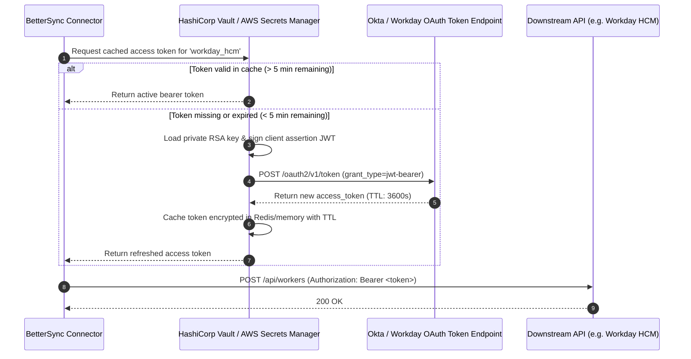

# Enterprise Authentication & Security Architecture
**BetterUp People Technology — BetterSync Engine**
*Bonus Deliverable: Authentication Approach (OAuth 2.0 / SSO / Token Management)*

---

## 1. Overview & Threat Model

People systems handle the most sensitive data in an enterprise: PII (Personally Identifiable Information), compensation figures, government IDs, home addresses, and system credentials.

A secure integration engine must guarantee:
1. **Confidentiality**: Zero plaintext credential storage; end-to-end TLS 1.3 encryption.
2. **Principle of Least Privilege**: Granular scopes per connector; no god-mode service accounts.
3. **Non-Repudiation**: Every system modification tied to a verified cryptographic identity.
4. **Token Security**: Automated short-lived token rotation with proactive refresh.

---

## 2. Authentication Approach Per System

```
+-------------------------------------------------------------------------------------------------------+
|                                  SECURITY & AUTHENTICATION MATRIX                                     |
+-------------------+-----------------------------+---------------------------------+-------------------+
| Target System     | Auth Mechanism              | Identity Model                  | Scopes / Grants   |
+-------------------+-----------------------------+---------------------------------+-------------------+
| Ashby ATS         | OAuth 2.0 Client Credential | Machine-to-Machine (M2M) App    | `candidates.read` |
|                   | + HMAC Webhook Signatures   |                                 | `offers.read`     |
+-------------------+-----------------------------+---------------------------------+-------------------+
| Workday HRIS      | OAuth 2.0 JWT Bearer Grant  | Integration System User (ISU)   | `Worker_Data:Put` |
|                   | + X.509 Certificate Signing | + Security Group Filtering      | `Staffing:Read`   |
+-------------------+-----------------------------+---------------------------------+-------------------+
| Okta / Lumos      | OAuth 2.0 Private Key JWT   | Okta Service App                | `okta.users.read` |
|                   | (RFC 7523)                  | (Restricted Lifecycle Admin)    | `okta.users.write`|
+-------------------+-----------------------------+---------------------------------+-------------------+
| ExpoIT Hardware   | OAuth 2.0 Bearer Token      | Partner Service Account         | `orders.create`   |
|                   | + Mutual TLS (mTLS)         |                                 | `orders.update`   |
+-------------------+-----------------------------+---------------------------------+-------------------+
| Slack Triage      | Slack Bot Token (xoxb-)     | BetterUp Bot App                | `chat:write`      |
|                   | + Request Signing Secret    |                                 | `channels:read`   |
+-------------------+-----------------------------+---------------------------------+-------------------+
```

---

## 3. Token Lifecycle & Vault Architecture



---

## 4. Webhook Invariant: Cryptographic Signature Verification

All incoming webhooks from Ashby, Workday, or Okta must pass constant-time HMAC verification before payload ingestion:

```python
import hmac
import hashlib

def verify_webhook_signature(raw_body: bytes, received_signature: str, secret_key: str) -> bool:
    """
    Prevents timing attacks using constant-time comparison (hmac.compare_digest).
    """
    expected = hmac.new(
        secret_key.encode("utf-8"),
        msg=raw_body,
        digestmod=hashlib.sha256
    ).hexdigest()
    return hmac.compare_digest(f"sha256={expected}", received_signature)
```

---

## 5. Okta Single Sign-On (SSO) & RBAC for People Ops Portal

For human operators accessing the BetterSync dashboard or reviewing Slack triage cards:
* **Protocol**: OpenID Connect (OIDC) via Okta SSO.
* **MFA Enforced**: FIDO2 WebAuthn / Okta Verify with Push.
* **Role-Based Access Control (RBAC)**:
  - `PeopleOps.Viewer`: Read-only access to cohort sync status and audit trail.
  - `PeopleOps.Admin`: Authority to approve Claude exception overrides and re-trigger syncs.
  - `System.Service`: Non-interactive service account for cron gatekeeper evaluations.
