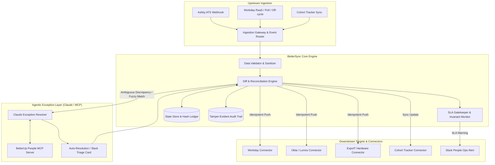
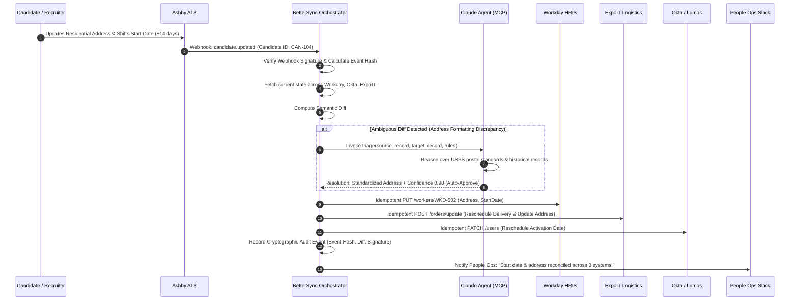

# Systems Map & Architecture Blueprint
**BetterUp People Technology — Onboarding Orchestration Engine**
*Author: Candidate Submission for AI Automation Engineer*

---

## 1. Executive Summary

BetterUp's onboarding workflow spans five distinct systems of record and engagement:
* **Ashby**: Applicant Tracking System (ATS) — primary entry point for candidates.
* **Workday**: Core Human Resources Information System (HRIS) — system of record for worker identity, legal profile, org hierarchy, and compensation.
* **Okta / Lumos**: Identity Provider (IdP) and Identity Governance and Administration (IGA) — manages corporate accounts, Google Workspace, Slack, and role-based app provisioning.
* **ExpoIT**: Hardware lifecycle & MDM logistics platform — handles laptop ordering, asset tagging, and direct-to-employee shipping.
* **Cohort Tracker (Google Sheets / Database)**: People Ops operational dashboard tracking onboarding cohorts, completion status, and cross-functional readiness.

### The Core Problem
Under high hiring velocity, cross-system coordination fails because:
1. **Changes Don't Propagate**: Post-offer adjustments (start dates shifting, legal/preferred name updates, residential address corrections) and off-cycle hires created directly in Workday do not ripple down to Okta, ExpoIT, or the cohort tracker.
2. **Bad Data Cascades**: Malformed addresses, typos in names, and invalid department codes entered into Ashby flow directly into Workday and shipping labels without schema normalization or pre-flight invariant checks.
3. **Silent SLA Gate Failures**: Critical onboarding gates (IT hardware forms submitted $\ge 7$ days before start, background checks cleared, Okta staged) lack active monitoring. Failures are discovered on Day 1 when the new hire has no laptop or account access.

---

## 2. As-Is Architecture vs. Failure Points

```
+--------------------------------------------------------------------------------------------------+
|                                    CURRENT AS-IS ARCHITECTURE                                    |
+--------------------------------------------------------------------------------------------------+

   [ Candidate Offer Accepted ]
                |
                v
       +-----------------+
       |   Ashby (ATS)   |
       +-----------------+
         |             |
(Manual / Zapier)  (Manual CSV Export / Sheet Sync)
         |             |
         v             v
+-----------------+   +-------------------------+
| Workday (HRIS)  |   | Cohort Tracker (Sheets) | <--- Often out of date; no sync back
+-----------------+   +-------------------------+
    |           |
 (Manual)    (Manual IT Ticket)
    |           |
    v           v
+--------+   +-------------------+
|  Okta  |   |  ExpoIT Hardware  | <--- Wrong address causes lost/delayed laptop!
+--------+   +-------------------+
    |
(Lumos / SCIM)
    v
Google / Slack

+--------------------------------------------------------------------------------------------------+
| FAILURE MODE 1: Changes Don't Propagate                                                          |
| Candidate signs offer -> Ashby start date moves from Oct 1 to Oct 15 -> Workday/Okta/ExpoIT      |
| never receive the update -> Laptop arrives 2 weeks early to empty porch; Okta account activates  |
| early or expires. Off-cycle hires created directly in Workday bypass the cohort tracker entirely. |
+--------------------------------------------------------------------------------------------------+
| FAILURE MODE 2: Bad Data Cascades                                                                |
| Typo in candidate name ("Jonh Doe") or invalid address ("Apt 4B" missing postal code) accepted   |
| in Ashby -> Writes malformed record to Workday -> Okta generates broken email jonh.doe@ ->       |
| FedEx shipping label fails validation at ExpoIT.                                                 |
+--------------------------------------------------------------------------------------------------+
| FAILURE MODE 3: Silent SLA Gate Failures                                                         |
| Day T-7 hardware order deadline passes without notification -> People Ops notices at T-1 ->      |
| Rush courier fees, delayed start, degraded new-hire experience.                                  |
+--------------------------------------------------------------------------------------------------+
```

---

## 3. Data Flow & Source of Truth Matrix

To eliminate split-brain data states, our architecture establishes clear, non-negotiable **System of Record (SoR)** boundaries:

| Entity / Attribute | System of Record (SoR) | Secondary Systems (Replicas) | Invariant Rules & Validation |
| :--- | :--- | :--- | :--- |
| **Recruitment Status** | Ashby | Workday (on hire), Cohort Tracker | Must have signed offer letter before handoff. |
| **Legal Identity & SSN** | Workday | Okta, Payroll | Verified against government ID / background check. |
| **Preferred Name & Title**| Workday | Ashby, Okta, Slack, Google | Preferred name takes precedence for Okta/Slack identity. |
| **Start Date** | Workday (post-hire) / Ashby (pre-hire) | Okta, ExpoIT, Cohort Tracker | Any shift $<7$ days out triggers hardware expedited alert. |
| **Shipping Address** | Ashby (initial) $\rightarrow$ Workday (final) | ExpoIT, Courier API | Must pass USPS/Postal standard normalization before dispatch. |
| **Identity & App Access** | Okta / Lumos | Google Workspace, Slack, Highspot | Account provisioning staged at T-7, activated at 06:00 Day 1. |
| **Hardware & Logistics** | ExpoIT | Cohort Tracker, Workday Asset ID | Hardware serial and tracking number linked back to HR profile. |

---

## 4. Target State Architecture: Event-Driven Reconciliation & Gatekeeper



---

## 5. The Chosen Slice: Unified Change Propagation & Invariant Gatekeeping

### Why This Slice Offers Maximum Leverage

When evaluating where to invest engineering effort across the three slices:

1. **Why not *only* simple Cross-System Data Validation?**
   Validation without change propagation is a dead end: catching a typo is helpful, but if start-date changes still fail to propagate or off-cycle hires are dropped, the biggest operational fire remains unaddressed.

2. **Why not *only* Exception Monitoring?**
   Alerting on missed deadlines in Slack helps People Ops catch fires, but does nothing to put them out automatically.

3. **The High-Leverage Solution: Unified Change Propagation + Invariant Gatekeeper + Claude Discrepancy Triage**:
   - **Solves Failure 1 (Propagation)**: An idempotent reconciliation engine detects differences between Ashby, Workday, Okta, and ExpoIT, synchronizing state whenever updates occur.
   - **Solves Failure 2 (Data Quality)**: Pre-propagation schema validation checks addresses, emails, and names before any downstream mutation.
   - **Solves Failure 3 (Gatekeeping)**: A dedicated invariant watcher monitors T-7 deadlines (hardware, background check, Okta staging) and alerts Slack or escalates.
   - **Where Claude Fits**: Real-world HR data is messy (e.g. "St." vs "Street", "Suite 400" entered into Address Line 1 vs 2, or candidate legal name change post-marriage). Instead of brittle regex or hard failures, **Claude is invoked as an agentic exception handler** to evaluate context, reason over the discrepancy, and either safely resolve it or draft an actionable Slack triage card.

---

## 6. Sequence Flow: Change Propagation with Agentic Triage



---

## 7. Boundary Guarantees & Non-Functional Requirements

* **Idempotency**: Every sync action generates an idempotency key derived from `sha256(entity_id + target_system + payload_hash + version)`. Replays of duplicate webhooks or network retries are guaranteed no-ops.
* **Failure Handling & Dead Letter Queue (DLQ)**: Connectors use exponential backoff with jitter for transient 429/503 errors. Hard failures route to a DLQ with state preserved for manual replay.
* **Auditability**: Every write, sync failure, or Claude agent decision is committed to an append-only audit trail containing timestamp, actor, input diff, confidence score, and downstream response.
